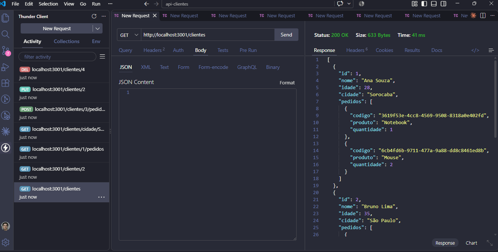
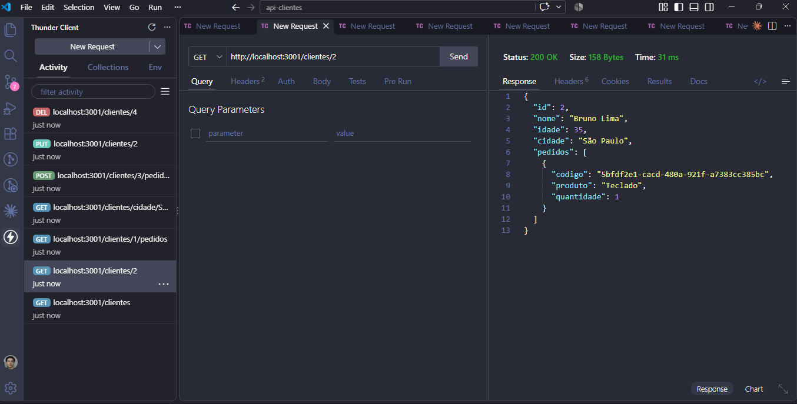
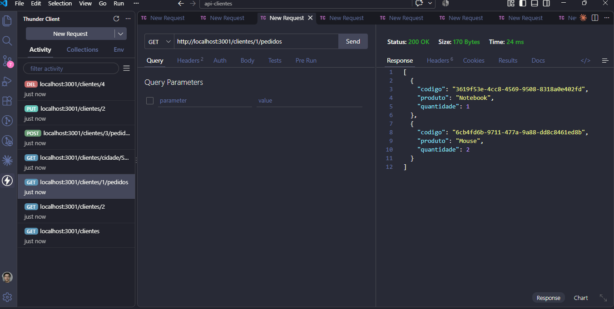
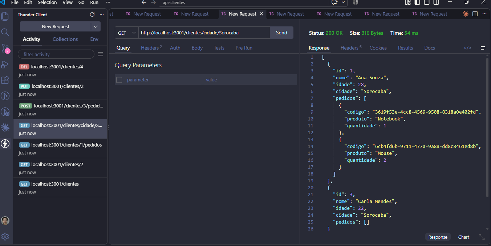
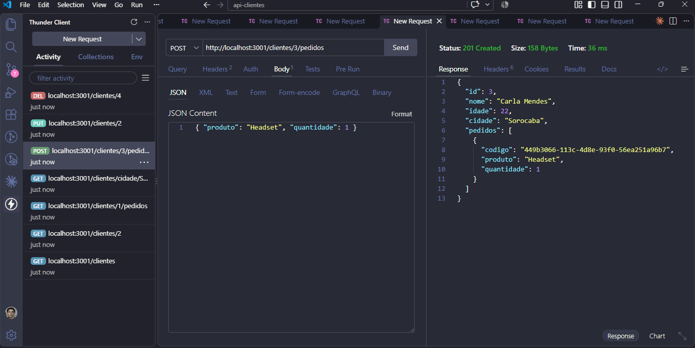
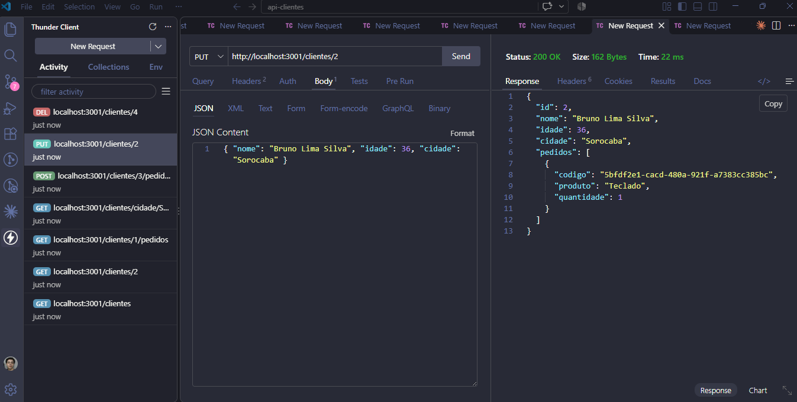
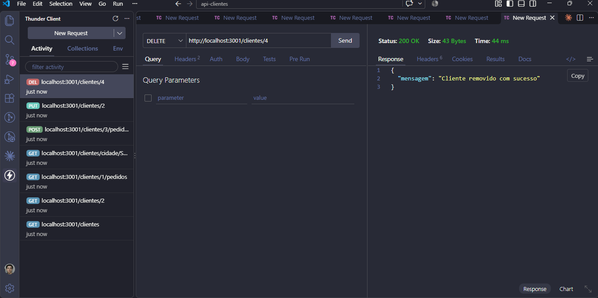
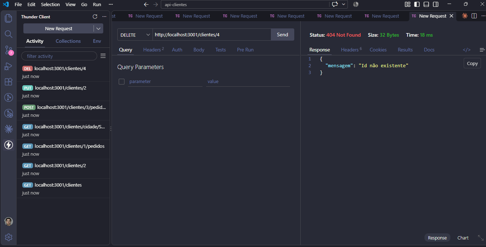

# AC2 – API de Clientes e Pedidos

API REST de gerenciamento de clientes e pedidos de uma loja virtual, desenvolvida com **Node.js** e **Express**.
Os dados ficam armazenados em memória (arrays e objetos JavaScript), sem banco de dados.

## Estrutura do projeto

```
api-clientes/
├── app.js                          # Arquivo principal: inicializa o Express e registra as rotas
├── routes/
│   └── clientes.js                 # Rotas de clientes (express.Router)
├── controllers/
│   └── clientesController.js       # Lógica dos endpoints e dados em memória
├── prints/                         # Evidências dos testes
└── package.json
```

## Como executar

```bash
npm install
npm run dev
```

A API fica disponível em `http://localhost:3001`.

## Estrutura de um cliente

```json
{
  "id": 1,
  "nome": "Ana Souza",
  "idade": 28,
  "cidade": "Sorocaba",
  "pedidos": [
    { "codigo": "81846262-3853-44cd-a294-83b8ba4d7238", "produto": "Notebook", "quantidade": 1 }
  ]
}
```

## Endpoints

| Método | Endpoint | Descrição | Corpo (JSON) |
|---|---|---|---|
| GET | `/clientes` | Lista todos os clientes | — |
| GET | `/clientes/:id` | Busca um cliente pelo id | — |
| GET | `/clientes/:id/pedidos` | Lista os pedidos de um cliente | — |
| PUT | `/clientes/:id` | Atualiza os dados de um cliente | `{ "nome": "...", "idade": 30, "cidade": "..." }` |
| POST | `/clientes/:id/pedidos` | Adiciona um pedido a um cliente | `{ "produto": "...", "quantidade": 1 }` |
| GET | `/clientes/cidade/:cidade` | Lista os clientes de uma cidade | — |
| DELETE | `/clientes/:id` | Remove um cliente | — |

Quando o cliente informado não existe, a API retorna status `404` com:

```json
{ "mensagem": "Id não existente" }
```

## Testes (Thunder Client / Postman)

### Listagem de clientes


### Busca por ID


### Listagem dos pedidos de um cliente


### Consulta de clientes por cidade


### Inclusão de pedido em um cliente existente


### Atualização de cliente


### Remoção de cliente


### Id não existente

